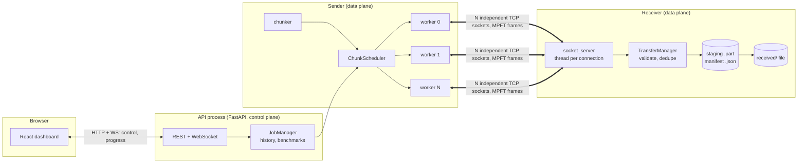
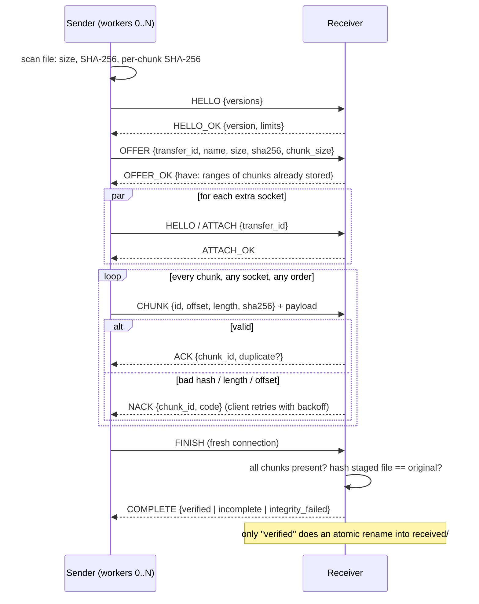

# Multipath Reliable File Transfer Using Concurrent Socket Connections

A file is split into numbered chunks and sent **simultaneously over several independent TCP connections**.
The receiver validates every chunk, accepts them in any order, rebuilds the file by byte offset, and publishes it
only after the final SHA-256 matches. Interrupted transfers can be resumed. A React dashboard shows the real
transfer live; a benchmark compares 1, 2, 4 and 8 connections.

* Data plane: pure Python `socket` + TCP (`client/`, `server/`, `common/`). **No HTTP is used to move file data.**
* Control plane: FastAPI (`api/`) starts jobs, streams real progress over a WebSocket, stores history.
* Dashboard: React + TypeScript + Vite + Recharts (`frontend/`).

## Contents
1. [Abstract and problem](#1-abstract-and-problem) 2. [Objectives and features](#2-objectives-and-features) 3. [Requirements and install](#3-requirements-and-installation)
4. [Run it](#4-running-it) 5. [Architecture](#5-architecture) 6. [Protocol specification](#6-protocol-specification-v1) 7. [Algorithms](#7-chunking-scheduling-and-reliability)
8. [API](#8-api-documentation) 9. [Testing](#9-testing) 10. [Benchmarking](#10-benchmarking-methodology) 11. [Demo script](#11-example-demonstration)
12. [Limitations and future work](#12-known-limitations-and-future-enhancements) 13. [Networking concepts](#13-computer-networks-concepts-demonstrated) 14. [Viva Q&A](#14-viva-questions-in-simple-language) 15. [Troubleshooting](#15-troubleshooting)

## 1. Abstract and problem
Sending one large file over one TCP connection has three weaknesses: one lost connection ruins the whole transfer, a single flow
may use only part of the available capacity, and TCP's checksum does not prove the *file* arrived intact. This project splits the
file into chunks, moves them over N parallel TCP sockets, checks each chunk and the whole file with SHA-256, and persists a manifest
so work is not repeated after a failure.

**"Multipath" here means application-level parallelism across several TCP connections.** They normally share the same network route.
Real path diversity needs different network interfaces or routing (policy routing, multi-homed hosts, or Multipath TCP in the OS).
This project does not claim to provide it.

## 2. Objectives and features
* Chunking with per-chunk ID, offset, length, SHA-256 and state (pending / in progress / completed / retrying / failed); last chunk may be short; empty files work.
* N independent sockets (1-16), each with a connection ID, claiming chunks from one shared scheduler (a chunk can never be claimed twice).
* Versioned binary framing protocol with ACK / NACK, size limits, timeouts, retries with exponential backoff + jitter, idempotent duplicate handling.
* Receiver: validates ID/offset/length/hash, stages to a temp file, keeps an atomic JSON manifest, verifies the final SHA-256, publishes atomically.
* Resume after cancel, socket loss, client crash or **server restart**; staged chunks are re-hashed on recovery.
* Pause / continue / cancel (see limits below), live dashboard, history, diagnostics, benchmark, safe download endpoint.
* Security basics: localhost default, explicit `--allow-remote`, filename sanitising, path confinement, size/chunk/connection limits, no pickle.

Final statuses: **verified** (complete and integrity verified) · **incomplete** (resumable) · **failed** · **integrity_failed**. A transfer is never "successful" merely because sockets closed.

## 3. Requirements and installation
Python 3.11+ (tested 3.12), Node 18+ (tested 22) for the dashboard. No external services.

macOS / Linux
```bash
python3 -m venv .venv && source .venv/bin/activate
pip install -r requirements.txt
cd frontend && npm install && npm run build && cd ..
```
Windows PowerShell
```powershell
py -m venv .venv; .\.venv\Scripts\Activate.ps1
pip install -r requirements.txt
cd frontend; npm install; npm run build; cd ..
```

## 4. Running it
**Easiest: dashboard (API + receiver in one process)**
```bash
python scripts/run_dashboard.py          # then open http://127.0.0.1:8000
```
The API starts an embedded receiver on `127.0.0.1:9000` (files land in `data/received/`). For frontend development run
`npm run dev` in `frontend/` (http://localhost:5173, proxies to the API on :8000).

**Separate receiver and command-line sender**
```bash
python scripts/run_server.py --port 9000                      # terminal 1 (add --allow-remote to listen on the LAN)
python scripts/run_client.py ./bigfile.iso --connections 4    # terminal 2 (--chunk-size-kb 1024, --restart)
```
To use an external receiver with the dashboard: `MPFT_EMBEDDED_RECEIVER=0` (PowerShell: `$env:MPFT_EMBEDDED_RECEIVER="0"`) and, for non-localhost targets, `MPFT_ALLOW_REMOTE_TARGETS=1`.

**No-dashboard demo** `python scripts/run_demo.py` (add `--resume` to see an interruption and resume). **Benchmark** see section 10.

Why does the dashboard first *copy* the chosen file? Browsers never reveal a file's real path, so the file is staged into `data/outbox/` on the sender machine (a local copy, not the transfer). The transfer is then done by TCP sockets from that staged file.

### Pause, resume, cancel: exactly what they do
* **Pause**: workers stop claiming chunks, finish the chunk in flight, then *close their sockets*. **Continue** reconnects them. Pause lives in the running sender process.
* **Cancel**: stops now. The receiver keeps every validated chunk.
* **Resume** (button on cancelled / incomplete / failed transfers, or just re-send the same file): a new job offers the same file; the receiver replies with the chunks it already holds and only the rest are sent. This works across sender restarts and receiver restarts. Resume requires the *same file, name and chunk size* (they define the stable transfer ID).

## 5. Architecture

| Folder | Role |
|---|---|
| `common/` | **One** authoritative wire protocol (`protocol.py`) and hash/geometry helpers (`integrity.py`) imported by both sides, so they cannot drift |
| `server/` | `socket_server.py` (accept + dispatch), `transfer_manager.py` (rules, sessions), `chunk_storage.py` (staging, manifest, publish, filename safety), `models.py`, `config.py`, `main.py` |
| `client/` | `chunker.py`, `scheduler.py`, `socket_client.py` (the `TransferJob` engine), `models.py`, `config.py`, `main.py` |
| `api/` | `main.py` (app, embedded receiver), `routes.py`, `job_manager.py`, `websocket_manager.py`, `schemas.py` |
| `frontend/src` | `pages/` (6 screens), `components/`, `services/` (API client, `useJob` live hook), `types/`, `styles/` |
| `tests/`, `scripts/`, `config/`, `data/` | pytest suite · run/demo/benchmark scripts · optional JSON config · runtime data (git-ignored) |

(This differs slightly from the suggested layout: protocol/integrity files live once in `common/` instead of twice.)

**Thread model.** Sender: one thread per socket + one throughput sampler; the API runs each job in its own thread so the event loop never blocks.
Receiver: accept thread + one thread per connection; a per-session lock serialises writes and manifest updates.

### Sequence of one transfer


## 6. Protocol specification (v1)
Defined once in `common/protocol.py`. Every message is a **frame**, big-endian:

```
 0      2     3     4          8          12
 +------+-----+-----+----------+----------+----------+----------------------+
 |"MF"  | ver | type| meta_len |payload_len| meta ... | payload ...          |
 +------+-----+-----+----------+----------+----------+----------------------+
```
* **Control frames** (everything except CHUNK): `meta` = UTF-8 JSON object, `payload_len` must be 0.
* **CHUNK frame**: `meta` is exactly 48 bytes `!IQI32s` = `chunk_id (u32) | offset (u64) | length (u32) | SHA-256 (32 B)`, followed by `length` payload bytes.
* **Limits (checked before allocating):** control JSON ≤ 1 MiB, payload ≤ 16 MiB protocol maximum (server default ≤ 8 MiB), ≤ 65,536 chunks per file.
* **Types:** `HELLO 1, HELLO_OK 2, OFFER 3, OFFER_OK 4, ATTACH 5, ATTACH_OK 6, CHUNK 7, ACK 8, NACK 9, FINISH 10, COMPLETE 11, ERROR 12`.
* **Framing:** TCP is a byte stream, so `recv_exact()` loops on `recv_into()` until the exact byte count arrives (`ConnectionClosed` if the peer hangs up mid-frame).
* **Version negotiation:** client lists `versions` in HELLO; server answers with the highest common one or ERROR `UNSUPPORTED_VERSION`.
* **Transfer ID:** first 32 hex chars of SHA-256 over `[filename, size, file_sha256, chunk_size]`. The server recomputes it, so a forged or mismatched ID is rejected, and the same file always maps to the same session (that is what makes resume safe).
* **ACK** `{chunk_id, duplicate}`; **NACK** `{chunk_id, code, message}` with codes `CHECKSUM_MISMATCH` (retryable), `BAD_CHUNK`, `DUPLICATE_MISMATCH`, `BAD_STATE`, `INTERNAL`; **ERROR** `{code, message}` ends a connection (`BAD_FRAME`, `LIMIT_EXCEEDED`, `BAD_METADATA`, `UNKNOWN_TRANSFER`, ...).
* **Chunk checks on the receiver:** id in range; `offset == id × chunk_size`; `length == expected length` (short only for the last chunk); payload length equals `length`; `SHA-256(payload) == claimed`.
* **COMPLETE** carries `status`, `original_sha256`, `received_sha256`, `expected_chunks`, `validated_chunks`, `missing_count`, `saved_as`.
* **Security note:** frames are plain TCP: **not encrypted or authenticated**. TLS is not implemented; wrapping sockets with `ssl.SSLContext` and explicit certificate files would be the next step. Do not use on untrusted networks.

## 7. Chunking, scheduling and reliability
**Chunking.** `count = ceil(size / chunk_size)`; chunk *i* covers `[i·cs, min((i+1)·cs, size))`. Empty file → 0 chunks (only the final verification runs). A 10 MB file with 1 MB chunks gives 10 chunks.

**Scheduler.** A deque of chunk IDs behind a `threading.Condition`. `claim()` pops one ID and marks it in-progress under the lock, so two workers can never get the same chunk. Failed chunks are pushed back as *retrying* and any worker may take them. Workers wait if the queue is empty but other chunks are still in flight (they might fail and need re-sending). The sender never starts more sockets than there are chunks, and all sockets are connected before the first chunk is claimed (a `Barrier`), so the parallelism is real from the start.

**Reliability mechanisms.**
| Failure | Handling |
|---|---|
| Payload corrupted in transit / wrong checksum | server NACK `CHECKSUM_MISMATCH`; chunk re-queued; up to `max_retries` (5) with backoff `0.2·2ⁿ` s + jitter, then marked *failed* |
| Socket dies mid-chunk | chunk re-queued (not charged to the chunk); the worker reconnects (`ATTACH`) up to `max_reconnects` (5) times, then the worker is retired and survivors finish the work |
| All sockets gone | job ends **incomplete** (never "success"); validated chunks stay on the receiver; resume sends the rest |
| Lost ACK / re-sent chunk | duplicate with the same hash → `ACK{duplicate:true}`, file untouched (idempotent); different hash for the same ID → NACK `DUPLICATE_MISMATCH` |
| Idle / hung peer | socket timeouts on both sides (30 s) |
| Receiver crash / kill / restart | every validated chunk is appended to a small **journal** (`data/manifests/<id>.journal`, one unbuffered write per chunk) and periodically folded into the JSON manifest. On restart the manifest is loaded, the journal replayed, and every recorded chunk is **re-read from the staging file and re-hashed** before being trusted; bad ones are dropped and re-requested. A `SIGKILL` therefore forgets no acknowledged chunk (tested with a real killed process) |
| Bad final hash | status `integrity_failed`, staging data discarded, nothing published |

**Receiver storage.** `data/staging/<id>.part` (pre-sized, chunks written by offset), `data/manifests/<id>.json` (full snapshot, written atomically with temp-file + `os.replace`, at most ~2/s and on every disconnect) and `data/manifests/<id>.journal` (append-only record of chunks validated since the last snapshot; deleted whenever a snapshot is written). On success the `.part` file is renamed into `data/received/` (never overwriting: a clash gets a suffix). Client filenames are reduced to a safe basename (`../x`, `C:\a\b`, device names, control characters), and the transfer ID, not the name, selects staging paths.

**Integrity verification.** Per-chunk SHA-256 catches damage immediately (and shows *which* chunk). The whole-file SHA-256 computed by the sender before sending is compared to a fresh hash of the reassembled file on disk. Only equality publishes the file.

## 8. API documentation
Interactive docs: http://127.0.0.1:8000/docs. Errors are always `{"error": {"code", "message"}}`.

| Method & path | Purpose |
|---|---|
| `GET /api/health`, `GET /api/config` | liveness; defaults, limits, receiver mode |
| `PUT /api/files?name=` (raw body) · `GET /api/files` · `DELETE /api/files/{id}` | stage a file for the sender; returns size + SHA-256 |
| `POST /api/transfers` `{file_id, host, port, connections, chunk_size, restart}` | start a transfer → `{job_id}` |
| `GET /api/transfers` · `GET /api/transfers/{id}` | list this session's jobs · full live snapshot (falls back to saved history) |
| `GET /api/transfers/{id}/connections` · `/events?since=` | per-socket stats · event log |
| `POST /api/transfers/{id}/pause` · `/continue` · `/cancel` · `/resume` | controls; `resume` starts a new job for cancelled/incomplete/failed ones |
| `GET /api/transfers/{id}/download` | the verified file, only if the receiver runs inside the API process; basename-confined |
| `GET /api/history` · `GET /api/history/{id}` | persisted summaries · full record with event log |
| `POST /api/benchmarks` · `GET /api/benchmarks[/{id}]` · `POST /api/benchmarks/{id}/cancel` | benchmark control and results |
| `WS /ws/transfers/{id}` | pushes `{"type":"snapshot","data":…}` ~2.5×/s, built from the live job (no synthetic data) |

The API only accepts localhost receivers by default (it would otherwise be a way to make the machine connect to arbitrary hosts).

## 9. Testing
```bash
python -m pytest            # everything (about 40 s)
python -m pytest -m "not slow"
```
**118 Python tests plus 4 frontend unit tests and a 4-test live UI flow, all passing** in the development environment (Python 3.12, Node 22). They use temp directories, deterministic data, loopback only.

| Required topic | Where |
|---|---|
| empty, tiny, < chunk, = chunk, partial last chunk, large (12 MiB) | `test_chunker.py`, `test_transfer.py` |
| out-of-order, duplicate delivery, corrupted payload, wrong checksum, bad offset/length/id | `test_transfer.py` (hand-written protocol client) |
| multiple concurrent connections (1/2/4/8; server sees them attached at once) | `test_transfer.py` |
| interrupted connections, retries, retry limit, dead link → *incomplete* | `test_failure_recovery.py` (fault-injecting TCP proxy) |
| missing-chunk detection, final SHA-256 equality / mismatch | `test_transfer.py` |
| resume, server-restart recovery, **real `SIGKILL` of the receiver process**, journal replay, bit-rot revalidation, cancel/pause | `test_resume.py` |
| malformed frames, oversized lengths, bad metadata, forged IDs | `test_protocol.py` |
| filename / path traversal, no overwrite, remote-bind opt-in | `test_security.py` |
| API, WebSocket, download, benchmark through FastAPI | `test_api.py` |

**Frontend tests** (`cd frontend`):
```bash
npm test            # unit tests (WebSocket URL builder, a regression for a bug found in audit)
npm run test:live   # needs `python scripts/run_dashboard.py` running; drives the real UI in jsdom:
                    # upload -> start -> live view -> integrity -> download, a rejected bad target, and a 1/2/4/8 benchmark
```
`test:live` runs in jsdom (no layout engine, canvas and chart APIs stubbed), so it proves the pages render real data and the buttons work, but **not** how the page looks. Check the visuals yourself in a browser.

**Not covered by automation:** pixel-level layout, transfers across a real network, files larger than ~40 MB in tests, Python 3.11 (code avoids newer features but was only run on 3.12), TLS (not implemented), and Windows/macOS behaviour (file renames are done after closing handles, but only Linux was exercised).

## 10. Benchmarking methodology
```bash
python scripts/benchmark.py --size-mb 256 --chunk-kb 1024 --repeats 3     # CLI, writes data/benchmark_results.json
```
or use the **Benchmark** page. It generates a seeded deterministic file, then sends it with each connection count in turn using the **same file and chunk size**, each as a fresh transfer (`restart`), and verifies integrity every time. Reported: total time, average MB/s (= bytes acknowledged ÷ transfer time, 1 MB = 10⁶ B), peak MB/s (highest sampled 2 s window, never below the average), bytes, retries, chunks, integrity, and speed-up vs. 1 socket.
Tips: use ≥ 256 MB (tiny files finish in milliseconds and measure noise), close other programs, use `--repeats 3`.

**Expect modest or no gains on localhost.** There is no real network on loopback, so limits are CPU (hashing, framing), thread switching and disk. In the author's sandbox a 32 MiB test finished in ~0.13 s for every setting, within about ±10 % of each other. Your numbers will differ; none are promised. More connections can help on a real, lossy or high-latency path (each flow's congestion window grows independently), and can hurt when overheads or competing flows dominate.

## 11. Example demonstration
1. `python scripts/run_dashboard.py` → open http://127.0.0.1:8000.
2. **New transfer** → drop a 50-200 MB file → 4 connections, 1 MiB chunks → Start.
3. **Live transfer**: watch the coloured lanes (one per socket, different chunk numbers at once), the chunk map filling in socket colours, throughput, retries and the event log.
4. Click **Pause**, then **Continue**; or **Cancel** and then **Resume transfer** and point out *"Server already holds N chunks"*.
5. **Integrity check**: two identical SHA-256 values and "Transfer complete and integrity verified"; **Download** the file.
6. Optional failure demo: `python scripts/run_demo.py --resume`.
7. **Benchmark** → run 1/2/4/8 and explain the (measured) result.

## 12. Known limitations and future enhancements
* **No encryption/authentication** (plain TCP). Future: TLS with explicit cert paths, or an HMAC handshake with a shared secret.
* One transfer ID per (name, size, hash, chunk size): changing the chunk size starts a new transfer. Resume needs the sender to still have the identical file.
* Durability scope: a killed receiver *process* loses nothing, because journal writes reach the OS immediately. A whole-machine crash or power cut can lose data still in the OS page cache; the re-hash on recovery detects that and the affected chunks are simply re-sent (no `fsync` per chunk, by design, for speed).
* The whole file is hashed before sending (one extra read pass); per-chunk hashes are not sent up front, so a corrupted *staged* chunk is detected by re-hashing against the receiver's own manifest.
* Pause closes the sockets (by design); it is not a TCP-level pause and is lost if the sender process dies (resume still works).
* The browser-staging copy duplicates the file once on the sender machine.
* Limits: 65,536 chunks, 4 GiB default max file, 16 sockets, 3 benchmark repeats. Receiver keeps all manifests in memory.
* Not true multipath: all sockets normally share one route. Future: bind each socket to a different local interface/IP (`socket.bind`), or use OS Multipath TCP.
* Future: adaptive chunk size / connection count, compression, per-chunk windowed pipelining (currently one chunk in flight per socket), multiple receivers.

## 13. Computer Networks concepts demonstrated
TCP byte-stream semantics and message framing · client/server sockets · concurrency with threads · parallel flows and congestion/fairness · application-layer protocol design (versioning, ACK/NACK, limits) · reliability layered above TCP (retransmission, backoff, idempotency) · end-to-end integrity (SHA-256) · timeouts and failure detection · session/resume state · input validation and safe file handling · control plane vs. data plane separation.

## 14. Viva questions in simple language
1. **Why divide a file into chunks?** Small pieces can be sent on different connections at the same time, checked one by one, and re-sent individually. A failure costs one chunk, not the whole file.
2. **Why use multiple TCP connections?** Each connection has its own congestion control and buffers, so several can keep a link busier than one, and if one dies the others continue. It only helps when the network (not the CPU/disk) is the bottleneck.
3. **Why is TCP not enough to guarantee file integrity?** TCP's 16-bit checksum protects each segment hop-by-hop, and a weak checksum can miss some errors. It does not protect against bugs, a bad disk write, a mixed-up chunk, or a partial file after a crash. SHA-256 checks the actual file end to end.
4. **ACK vs NACK?** ACK = "chunk *n* received and valid." NACK = "chunk *n* rejected, and here is why" (e.g. checksum mismatch), so the sender knows to retry or give up without waiting for a timeout.
5. **Why can chunks arrive out of order?** They travel on different connections with different timing, and the scheduler hands them out as sockets become free. That is fine because every chunk carries its own ID and offset.
6. **How is the original file rebuilt?** Each valid chunk is written at `offset = id × chunk_size` in a pre-sized staging file, so the order of arrival does not matter. After every chunk is present, the whole file is hashed and then renamed into place.
7. **What does SHA-256 verify?** That the bytes are exactly the same as the original: any change, even one bit, gives a completely different hash. It verifies integrity, not secrecy or who sent it.
8. **How are failed connections handled?** The chunk that was in flight goes back into the queue, the worker waits (exponential backoff) and reconnects, and other workers can pick up the chunk. A worker that keeps failing is retired. If everything fails the transfer is "incomplete" and can be resumed.
9. **How does resumption work?** The receiver saves a manifest of validated chunks. When the same file is offered again (same stable transfer ID), it replies with the chunks it already has (after re-hashing them), and only the rest are sent.
10. **Do multiple TCP connections mean multiple physical paths?** No. They are separate flows, usually over the same route. Different physical paths need different interfaces/routing or Multipath TCP.
11. **Why might eight connections be slower than four?** More threads, context switches, hashing and disk seeks; more flows competing with each other on a congested link; and each socket has fixed handshake and ACK overhead. Past the point where the bottleneck is saturated, extra connections only add cost.
12. **What if the final checksum does not match?** The receiver reports `integrity_failed`, publishes nothing, and discards the staged file so a clean re-send starts fresh. The dashboard shows both hashes.
13. **TCP reliability vs application-level reliability?** TCP reliably delivers bytes within *one* connection while it lives. The application must handle things TCP cannot: a connection that dies, chunks split across connections, a restart, damaged storage, duplicates after retries, and proving the *file* is correct.
14. **How does the receiver stop duplicates corrupting the file?** Chunks are recorded by ID under a lock. A repeat with the same hash is acknowledged but not rewritten (idempotent); a repeat with a different hash is rejected. Because a chunk always goes to its fixed offset, even a rewrite would produce identical bytes.

## 15. Troubleshooting
* *Dashboard says API offline*: start `python scripts/run_dashboard.py`; check port 8000 is free.
* *API fails at startup with "Cannot start the embedded receiver"*: port 9000 is taken (often an old receiver). Stop it, set `MPFT_RECEIVER_PORT`, or set `MPFT_EMBEDDED_RECEIVER=0`.
* *Blank page at :8000*: run `npm run build` in `frontend/` first (or use `npm run dev` on :5173).
* *Receiver refuses `0.0.0.0`*: by design, add `--allow-remote` and understand the traffic is unencrypted.
* *Remote host rejected by the dashboard*: set `MPFT_ALLOW_REMOTE_TARGETS=1` for the API process.
* *Transfer shows "incomplete"*: click **Resume transfer**; use "Start over" only to discard the receiver's partial copy.
