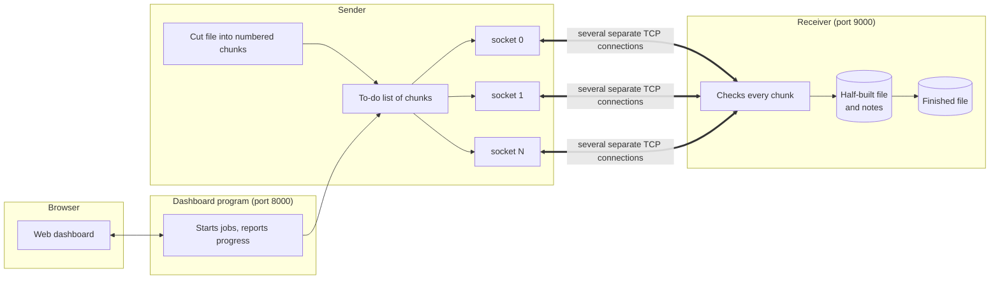
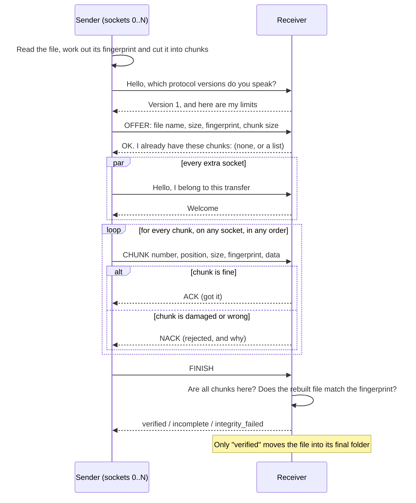

# Multipath File Transfer

**Send a file from one computer to another using several network connections at the same time, and prove that it arrived perfectly.**

This is a Computer Networks project. It is a real, working program, not a mock-up: the numbers you see on screen come from actual transfers.

---

## 1. What is this, in plain words?

Imagine you are moving house and you have 400 boxes to carry.

* You **number every box** and write down what is inside each one.
* You use **8 trucks at once** instead of 1. The trucks do not need to arrive in order, because every box has a number.
* At the new house, someone **checks each box** against the list. A damaged box is sent back and replaced.
* If a truck breaks down, the other trucks **carry its boxes**.
* If everything stops half way, the new house already knows which boxes arrived. You **only carry the missing ones**.
* At the end the whole house is compared with the original list. Only if it is **exactly the same** do you say "done".

That is exactly what this project does with a file:

| In the story | In the project |
|---|---|
| The house contents | The file you want to send |
| A numbered box | A **chunk** (a small numbered piece of the file) |
| A truck | A **socket** (one TCP network connection) |
| Checking a box | A **checksum** on every chunk |
| The final comparison | A **SHA-256** fingerprint of the whole file |
| "Which boxes arrived?" after a stop | **Resume** |

You choose a file in a web page, press **Start transfer**, and watch the chunks travel over the sockets live.

### Is it really "multipath"?
Honest answer: **not in the strict sense.** Our connections are separate, but they normally travel over the *same* physical route (for example the same Wi-Fi). Real multipath would need different network cards or routes. What we do is called *parallel connections*. The word "multipath" is used in the project title, and this section is here so nobody is misled.

---

## 2. What you need

* **Python 3.11 or newer.** Check with `python --version` (on Mac/Linux it may be `python3 --version`).
* **Node.js 18 or newer**, only if you want the web dashboard. Check with `node --version`.
* About 200 MB of free disk space, plus room for the files you send.
* No accounts, no internet connection, no database. Everything runs on your own computer.

---

## 3. Quick start (about 5 minutes)

Open a terminal (Windows: **PowerShell**; Mac: **Terminal**), go into the project folder, then follow the steps for your system.

### Step 1: install the Python parts (once)

**Windows PowerShell**
```powershell
py -m venv .venv
.\.venv\Scripts\Activate.ps1
pip install -r requirements.txt
```
**macOS or Linux**
```bash
python3 -m venv .venv
source .venv/bin/activate
pip install -r requirements.txt
```
*What this does:* it creates a private box (`.venv`) for this project's Python libraries and installs them there, so nothing else on your computer is touched. If PowerShell refuses to run the activate script, run `Set-ExecutionPolicy -Scope Process Bypass` and try again.

### Step 2: build the web page (once)

```bash
cd frontend
npm install
npm run build
cd ..
```
*What this does:* it downloads the web page's libraries and turns the source code into a ready-to-use web page. You only repeat it if you change the files inside `frontend/`.

### Step 3: start everything

```bash
python scripts/run_dashboard.py
```
*(On Mac/Linux you may need `python3`.)*

*What this does:* it starts two things inside one program: the **web server for the dashboard** (port 8000) and a **receiver** that listens for files (port 9000). You will see log lines; leave the window open.

### Step 4: open the dashboard and send your first file

1. Open **http://127.0.0.1:8000** in your browser.
2. Click **New transfer**.
3. Click **Choose a file** and pick any file (a photo, a PDF, a video).
4. Leave the other settings alone and click **Start transfer**.
5. You land on **Live transfer**. When it says **Complete, integrity verified**, click **Integrity check**. You will see two identical long codes: that is the proof the file is perfect.
6. Your received copy is in the folder **`data/received/`**. On the Integrity page there is also a **Download verified file** button.

That is it. Everything below explains things in more detail.

> **Try it without a browser:** `python scripts/run_demo.py` sends a generated file and prints the result. `python scripts/run_demo.py --resume` also stops a transfer half way and shows it continuing from where it stopped.

---

## 4. Send a file (for example a PDF) from one PC to another

You need two computers on the **same network** (same Wi-Fi or router). Both need Python 3.11+ and a copy of this project folder. The receiver and the command-line sender use only what comes with Python, so **nothing needs to be installed with pip** on them.

I will call them the **receiver PC** (gets the file) and the **sender PC** (has the file). Example address of the receiver: `192.168.1.20`.

**Step 1. On the receiver PC: find its address.**
* Windows: run `ipconfig` and read **IPv4 Address**.
* Mac: run `ipconfig getifaddr en0` (Wi-Fi).
* Linux: run `hostname -I`.

**Step 2. On the receiver PC: let port 9000 through the firewall.** (A firewall blocks unknown visitors; this opens one door.)
* Windows (PowerShell **as Administrator**):
  `New-NetFirewallRule -DisplayName "MPFT receiver" -Direction Inbound -Protocol TCP -LocalPort 9000 -Action Allow`
* Linux: `sudo ufw allow 9000/tcp`
* Mac: click **Allow** when it asks if Python may accept incoming connections.

**Step 3. On the receiver PC: start the receiver and leave it running.**
```bash
python scripts/run_server.py --host 0.0.0.0 --port 9000 --allow-remote
```
*(Mac/Linux: `python3`.)* `--host 0.0.0.0` means "listen on the network, not only on this computer". `--allow-remote` is a deliberate safety switch you must type on purpose, because the connection is **not encrypted**. Received files appear in this PC's `data/received/` folder.

**Step 4. On the sender PC: test that the receiver can be reached.**
* Windows: `Test-NetConnection 192.168.1.20 -Port 9000` and look for `TcpTestSucceeded : True`.
* Mac/Linux: `nc -vz 192.168.1.20 9000`.

If this fails, jump to *Troubleshooting* (section 12).

**Step 5. On the sender PC: send the PDF.** Pick one way:

* **Command line (simplest):**
  ```bash
  python scripts/run_client.py "C:\Users\me\report.pdf" --host 192.168.1.20 --port 9000 --connections 4 --chunk-size-kb 256
  ```
  It prints `status: completed` and two identical `sha256` lines.
* **Dashboard:** do the Quick start (steps 1 and 2) on the sender PC, then start the dashboard pointing at the other PC.
  * Windows PowerShell:
    `$env:MPFT_EMBEDDED_RECEIVER="0"; $env:MPFT_ALLOW_REMOTE_TARGETS="1"; python scripts/run_dashboard.py`
  * Mac/Linux:
    `MPFT_EMBEDDED_RECEIVER=0 MPFT_ALLOW_REMOTE_TARGETS=1 python3 scripts/run_dashboard.py`

  Then open http://127.0.0.1:8000, click **New transfer**, choose the PDF, type the receiver's address (`192.168.1.20`) and port `9000`, and click **Start transfer**.

**Step 6. On the receiver PC: open `data/received/report.pdf`.** If a file with that name is already there, the new one gets a short suffix (like `report_7650519a.pdf`). **Nothing is ever overwritten.** To double-check by hand, compare the fingerprints: Windows `Get-FileHash report.pdf -Algorithm SHA256`, Mac `shasum -a 256 report.pdf`, Linux `sha256sum report.pdf`.

**Good to know**
* A small PDF is only one or two chunks, and a file never uses more sockets than it has chunks. To *see* parallel sockets, use a small chunk size (`--chunk-size-kb 64`, or 256 KiB in the dashboard) or send a bigger file.
* When you finish, press **Ctrl+C** on the receiver and remove the firewall rule: `Remove-NetFirewallRule -DisplayName "MPFT receiver"`.
* Do not leave the receiver open on a public network. Sending over the internet needs a VPN or port forwarding and is not covered here.

---

## 5. A tour of the dashboard

The top bar has six pages. On the right it tells you whether the receiver is listening.

### Overview
A summary of the latest transfer: how much was sent, current and average speed, how many sockets are busy, how many chunks are done, and whether the integrity check passed. Below it: your recent transfers.

### New transfer
1. **File.** Choose or drag a file. It is copied into `data/outbox/` first. (Why? A web page is not allowed to know where a file lives on your disk, so the program needs its own copy to read from. This copy is only a hand-off; the real transfer uses network sockets.)
2. **Receiver address and port.** Where to send it. The default is this same computer.
3. **Parallel TCP connections** (1, 2, 4 or 8). How many "trucks".
4. **Chunk size** (256 KiB, 1 MiB or 4 MiB). How big each "box" is.
5. **Start over.** Leave it unticked normally. Tick it to throw away any half-finished copy on the receiver and send everything again.

You also see the file's name, size, **SHA-256 fingerprint** and how many chunks it will be cut into.

### Live transfer (the most interesting page)
* **The sentence at the top** tells you the state and the numbers in plain words: speed now, average speed, best speed, how much has arrived, how many chunks are done, how many had to be re-sent, and an estimated time left (clearly an estimate).
* **The square map.** One small square per chunk, in file order. Grey = waiting. A coloured square = done, and the colour tells you **which socket carried it**. Hover a square to see details.
* **Sockets over time (the timing diagram).** Each row is one connection. Each bar is one chunk, drawn from the moment it was sent until the receiver confirmed it. Bars on different rows that overlap in time are chunks travelling **in parallel**. That is the whole idea of the project, made visible.
  * Solid colour = confirmed.
  * Striped = still travelling.
  * **Red outline** = the receiver rejected it (it was damaged), so it was sent again.
  * **Dashed outline** = the connection broke while this chunk was on the way.
* **Speed.** A line of MB/s over time (solid = recent speed, dashed = average).
* **Sockets.** A table with chunks, data, speed, re-sends and errors per connection.
* **Chunks.** A full table of every chunk (click to open it).
* **Event log.** A diary of what happened, such as "Chunk 91 rejected".

Buttons on this page:

| Button | What it really does |
|---|---|
| **Pause** | Each socket finishes the chunk it is carrying, then closes. Nothing is lost. |
| **Continue** | The sockets reconnect and carry on. |
| **Cancel** | Stops now. The receiver **keeps** every chunk it already checked. |
| **Resume transfer** | Appears after a cancel or failure. Sends only the chunks the receiver is missing. |

### Integrity check
The proof page. It shows the file's SHA-256 fingerprint computed by the **sender before sending** and by the **receiver after rebuilding**. If they are identical, the file is exactly the original. If not, the differing characters are highlighted. It also lists how many chunks were expected, validated, missing, and where the file was saved.

### History
Every finished transfer is saved, with its time, size, sockets, speed, re-sends and result. Click a row to read its full event log. A cancelled or interrupted transfer has a **Resume this transfer** link.

### Benchmark
Sends the **same data** with 1, 2, 4 and 8 sockets, one after another, and shows time and speed for each. The numbers are measured, not made up. See section 9 for what to expect.

---

## 6. How it works (simple version)



Two separate jobs are kept apart on purpose:

* **The web page and the dashboard program** only *control* things (start, pause, show progress).
* **The file itself never travels through the web page.** It goes over plain TCP sockets, straight from the sender program to the receiver program.

### A transfer, step by step



In words:

1. **Prepare.** The sender reads the file, computes its fingerprint, and cuts it into chunks. Every chunk gets a number, a position in the file, a size and its own fingerprint.
2. **Offer.** The sender tells the receiver about the file. The receiver replies with the chunks it already has (this is what makes resume work).
3. **Open the sockets.** Extra connections join the same transfer.
4. **Send.** Each socket takes the next chunk from a shared to-do list. The list gives each chunk to **exactly one** socket at a time, so no two sockets send the same chunk.
5. **Check.** The receiver checks the number, position, size and fingerprint of every chunk. Good: it writes the chunk at the right spot in a half-built file and says **ACK**. Bad: it says **NACK** and the sender tries again after a short wait.
6. **Finish.** When every chunk is confirmed, the sender asks the receiver for a final check. The receiver fingerprints the whole rebuilt file.
7. **Publish.** Only if the fingerprint matches the original is the file moved into `data/received/`. If not, nothing is published.

A transfer is **never** called successful just because the connections closed.

---

## 7. What happens when things go wrong?

| Problem | What the project does |
|---|---|
| A chunk is damaged on the way | The receiver rejects it (NACK). The sender waits a moment and re-sends it, up to 5 times. After that the chunk is marked failed and the transfer ends as "incomplete" (resumable). |
| One connection breaks | The chunk it carried goes back on the to-do list. The socket waits, reconnects (up to 5 times) and other sockets can pick up the chunk. A socket that keeps failing is retired; the rest finish the job. |
| Every connection is lost | The transfer ends as **incomplete**, never as success. Chunks already checked stay on the receiver. Click **Resume transfer** later. |
| The same chunk arrives twice | The receiver notices, answers ACK, and does **not** write it again. The file cannot be corrupted by repeats. |
| Something goes silent | Both sides give up on a connection that is quiet for 30 seconds. |
| The receiver program crashes or is killed | It keeps a small notebook (a "journal") of every chunk it verified, written immediately. On restart it reads the notebook and **re-checks every recorded chunk against the saved data** before trusting it. In a test, a receiver killed in the middle of a 200 MB transfer lost no acknowledged chunk. |
| The whole computer loses power | Very recent chunks might be lost from the disk cache. The re-check on restart notices, and only those chunks are re-sent. |
| The finished file does not match the fingerprint | Reported as **integrity failed**. Nothing is published, the half-built file is thrown away, and a fresh send starts clean. The dashboard shows both fingerprints with the differences highlighted. |
| A bad file name such as `../../secret.txt` | Only the plain file name is kept (`secret.txt`). Files are only ever written inside the received folder. |

---

## 8. Safety notes (please read)

* **The connection is not encrypted.** Anyone who can watch the network could read the file. Use it on your own computer or a network you trust. (Adding TLS is listed as future work.)
* **The receiver only listens on this computer by default.** Listening to the network needs `--allow-remote`, typed on purpose.
* **The dashboard only sends to this computer by default.** Sending to another address needs `MPFT_ALLOW_REMOTE_TARGETS=1`. This stops the dashboard being used to make your computer connect to random addresses.
* The receiver enforces limits: file size (default 4 GiB), chunk size, number of chunks (65,536) and connections per transfer.
* Everything the other side sends is checked before it is used. The program never runs received files and never uses Python's unsafe `pickle`.

---

## 9. Benchmark: what to expect

```bash
python scripts/benchmark.py --size-mb 256 --chunk-kb 1024 --repeats 3
```
or use the **Benchmark** page. It makes a test file (the same bytes every time), then sends it with the socket counts you choose, one after another, with the same chunk size, and checks integrity each time. It reports total time, average speed, best speed, data sent, re-sends, chunks, and how many times faster or slower than 1 socket.

**Speed = bytes confirmed ÷ transfer time.** (1 MB means 1,000,000 bytes everywhere in the project.)

**More sockets do not always mean faster.** On one computer ("localhost") there is no real network, so the limit is the processor and the disk, and extra sockets just add work. On our test machine all four settings were within about ±10 % of each other, and 1 socket was often the fastest. On a real, busy or slow network, several connections can help, but once the link is full they only compete. Your numbers will be different, and none are promised.

Tips for a fair test: use a big file (256 MB or more), close other programs, and use 3 repeats.

---

## 10. Testing

```bash
python -m pytest                 # all Python tests, about 50 seconds
python -m pytest -m "not slow"   # skip the largest one
```
**120 Python tests, 9 frontend unit tests and a 4-test live UI check, all passing** when last run (Python 3.12, Node 22). They use temporary folders and the local computer only; they never touch your own files.

For the frontend:
```bash
cd frontend
npm test            # small unit tests (WebSocket address, speed curve and axis maths)
npm run test:live   # needs the dashboard running (python scripts/run_dashboard.py)
```
`test:live` drives the real pages inside a simulated browser: upload, start, live view, integrity, download, a rejected bad address, and a 1/2/4/8 benchmark.

| What is tested | Where |
|---|---|
| Empty file, tiny file, smaller than a chunk, exactly one chunk, partial last chunk, 12 MB file | `test_chunker.py`, `test_transfer.py` |
| Chunks out of order, duplicate chunks, damaged chunks, wrong fingerprints, wrong positions or sizes | `test_transfer.py` (a hand-made client sends the bad data) |
| 1, 2, 4 and 8 connections at once | `test_transfer.py` |
| Dropped connections, retries, retry limit, a dead network ending as "incomplete" | `test_failure_recovery.py` (a fault-making network proxy) |
| Missing chunks, final fingerprint equal or different | `test_transfer.py` |
| Resume, restart of the receiver, **receiver process killed with SIGKILL**, damaged data on disk, cancel, pause, cancel not counted as errors | `test_resume.py` |
| Broken or oversized messages, wrong metadata, forged IDs | `test_protocol.py` |
| Bad file names, no overwriting, remote listening switch | `test_security.py` |
| The dashboard's web API, live updates, download, benchmark | `test_api.py` |

**Not tested automatically:** exactly how the pages look on every screen, transfers across a real network or between two real computers (the two-PC steps were checked using a non-loopback address on one machine, but not on two physical PCs), Python 3.11, and Windows or Mac (only Linux was used for testing).

---

## 11. What is where (project map)

```
common/        The protocol (the "language" both sides speak) and the fingerprint helpers. Used by BOTH sides.
server/        The receiver: accepts connections, checks chunks, keeps notes, builds and publishes the file.
client/        The sender: cuts the file up, runs the sockets, retries, pause/cancel.
api/           The dashboard program: starts jobs, sends live updates to the browser, saves history.
frontend/      The web page (React + TypeScript). Source is in frontend/src.
scripts/       Ready-made commands: run_dashboard, run_server, run_client, run_demo, benchmark.
tests/         The automatic tests.
demo_files/    (optional) big sample files for demos. The program itself does not need this folder.
config/        An example settings file for the receiver (optional).
data/          Created while running. received/ = finished files, staging/ = half-built files,
               manifests/ = the receiver's notes, outbox/ = files copied from the browser.
```
`data/` holds your files and is ignored by git. Delete files in it freely when you no longer need them.

**Other commands you may want**

* Receiver only: `python scripts/run_server.py --port 9000` (options: `--host`, `--data-dir`, `--allow-remote`, `--max-file-size-mb`, `--config`, `-v`).
* Command-line sender: `python scripts/run_client.py FILE --host 127.0.0.1 --port 9000 --connections 4 --chunk-size-kb 1024` (options: `--restart`, `--json`).
* Use an outside receiver with the dashboard: set `MPFT_EMBEDDED_RECEIVER=0`. Other settings: `MPFT_RECEIVER_PORT`, `MPFT_DATA_DIR`, `MPFT_ALLOW_REMOTE_TARGETS`.
* Developing the web page: in `frontend/` run `npm run dev` and open http://localhost:5173 (the dashboard program must also be running).

---

## 12. Troubleshooting

| What you see | What it means and what to do |
|---|---|
| "The dashboard cannot reach the API" / "API not reachable" | The dashboard program is not running. Run `python scripts/run_dashboard.py` and reload the page. |
| Blank page at http://127.0.0.1:8000 | The web page was not built. Run `npm install` then `npm run build` inside `frontend/`. |
| The dashboard program stops with "Cannot start the embedded receiver" | Port 9000 is already in use (often an old receiver still running). Close it, or set `MPFT_RECEIVER_PORT` to another number. |
| "Refusing to bind to non-loopback address" | You asked the receiver to listen on the network without `--allow-remote`. Add it only if you understand the data is unencrypted. |
| "Only localhost receivers are allowed" (dashboard) | Start the dashboard with `MPFT_ALLOW_REMOTE_TARGETS=1` to send to another computer. |
| "cannot start transfer: Connection refused" or "timed out" | The receiver is not running, the address or port is wrong, a firewall is blocking port 9000, or the two computers are not on the same network. Check with the test in section 4, step 4. Public or guest Wi-Fi often blocks computers from talking to each other. |
| Status "Stopped early, can be resumed" | Some chunks did not arrive. Click **Resume transfer**. Only the missing chunks are sent. |
| Status "Integrity check failed" | The rebuilt file did not match. Nothing was saved. Send it again (tick **Start over**). If it keeps happening, suspect the disk or the network. |
| I only see 1 or 2 sockets working | The file is small, so it has few chunks, and a file never uses more sockets than chunks. Use a smaller chunk size or a bigger file. |
| Windows blocks the PowerShell script | Run `Set-ExecutionPolicy -Scope Process Bypass` in that window, then try again. |
| `python` is not found | On Mac/Linux use `python3`. On Windows try `py`. |

---

## 13. Words you may meet (glossary)

| Word | Meaning |
|---|---|
| **TCP** | The normal reliable way computers send data over a network. It delivers bytes in order, but only within one connection while it stays alive. |
| **Socket** | One end of a network connection, the "truck" in our story. |
| **Chunk** | A small numbered piece of the file. |
| **Offset** | Where a chunk belongs in the file (how many bytes from the start). The receiver writes each chunk at its offset, so arrival order does not matter. |
| **Checksum / fingerprint / SHA-256** | A short code worked out from data. Change even one bit and the code changes completely. Equal codes mean equal data. SHA-256 is the method we use. |
| **ACK** | "I received this chunk correctly." |
| **NACK** | "I rejected this chunk, and here is why." |
| **Retry / backoff** | Trying again after a growing pause (0.2 s, 0.4 s, 0.8 s...), so we do not hammer a struggling connection. |
| **Idempotent** | Doing the same thing twice has the same result as once. Receiving the same chunk twice changes nothing. |
| **Manifest / journal** | The receiver's notes of which chunks it has verified. They make resume possible. |
| **Resume** | Continuing an unfinished transfer by sending only what is missing. |
| **Staging file** | The half-built file the receiver writes into. It only becomes the real file after the final check. |
| **Localhost / 127.0.0.1** | "This same computer." |
| **Port** | A numbered door on a computer. We use 9000 for files and 8000 for the dashboard. |
| **Throughput** | How much data moves per second (MB/s). |

---

## 14. For the curious: technical details

You do not need this section to use the project.

### The protocol (version 1)
Defined once in `common/protocol.py` and shared by both sides, so they cannot disagree. Every message is a **frame**:

```
 bytes: 0-1   2      3      4-7        8-11         then
        "MF"  ver    type   meta_len   payload_len  meta, then payload
```
* **Control messages** (everything except CHUNK) carry a JSON object as `meta` and have no payload.
* A **CHUNK** message has a fixed 48-byte binary `meta` (`chunk id` 4 bytes, `offset` 8 bytes, `length` 4 bytes, `SHA-256` 32 bytes) followed by the raw chunk data.
* **Limits are checked before any memory is used:** control messages up to 1 MiB, chunk data up to 16 MiB at most (the receiver's own default is 8 MiB), at most 65,536 chunks per file.
* TCP is a stream with no message boundaries, so the program reads with `recv_exact()`, which keeps reading until it has exactly the number of bytes it needs.
* **Message types:** `HELLO`, `HELLO_OK`, `OFFER`, `OFFER_OK`, `ATTACH`, `ATTACH_OK`, `CHUNK`, `ACK`, `NACK`, `FINISH`, `COMPLETE`, `ERROR`.
* **Transfer ID:** the first 32 characters of the SHA-256 of `[file name, size, file fingerprint, chunk size]`. The receiver recomputes it, so a forged ID is rejected, and the same file always gets the same ID, which is what makes resume safe.
* **What the receiver checks on every chunk:** the number is in range, the offset equals `number × chunk size`, the length is right (only the last chunk may be shorter), and the data's SHA-256 equals the claimed one.
* **Error codes:** `CHECKSUM_MISMATCH` (will be retried), `BAD_CHUNK`, `DUPLICATE_MISMATCH`, `BAD_STATE`, `BAD_FRAME`, `LIMIT_EXCEEDED`, `BAD_METADATA`, `UNKNOWN_TRANSFER`, `UNSUPPORTED_VERSION`, `INTERNAL`.

### Chunking and scheduling
`number of chunks = ceil(file size ÷ chunk size)`. Chunk *i* covers bytes `[i × size, min((i+1) × size, file size))`. An empty file has 0 chunks and only the final check runs.

The scheduler is a list of chunk numbers guarded by a lock. A socket takes one number at a time, so two sockets can never claim the same chunk. A failed chunk goes back on the list. All sockets connect before any chunk is claimed, so the parallelism is real from the first moment. A transfer never opens more sockets than it has chunks.

### How the receiver stores things
* `data/staging/<id>.part`: the half-built file, pre-sized, each chunk written at its offset.
* `data/manifests/<id>.json`: a full snapshot of what is verified, written safely (temp file, then rename) at most about twice a second and whenever a connection closes.
* `data/manifests/<id>.journal`: a tiny line added for every verified chunk with one direct write. It survives the process being killed. It is deleted whenever a new snapshot is written.
* On restart the snapshot is loaded, the journal replayed, and every chunk is re-read and re-hashed before it is trusted.
* A finished file is moved into `data/received/` with an atomic rename, and never over an existing file.

### Threads
Sender: one thread per socket plus one that measures speed. Dashboard program: each transfer runs in its own thread so the web server never freezes. Receiver: one thread to accept connections and one per connection; a lock per transfer keeps writes and notes consistent.

### The dashboard's web API
Interactive documentation is at http://127.0.0.1:8000/docs. Errors always look like `{"error": {"code": "...", "message": "..."}}`.

| Request | What it does |
|---|---|
| `GET /api/health`, `GET /api/config` | Is it alive; defaults and limits |
| `PUT /api/files?name=...` (raw body), `GET /api/files`, `DELETE /api/files/{id}` | Copy a file in for sending; list; remove |
| `POST /api/transfers` | Start a transfer: `file_id`, `host`, `port`, `connections`, `chunk_size`, `restart` |
| `GET /api/transfers`, `GET /api/transfers/{id}` | This session's transfers; full live state of one |
| `GET /api/transfers/{id}/connections`, `/events?since=` | Per-socket numbers; the event log |
| `POST /api/transfers/{id}/pause`, `/continue`, `/cancel`, `/resume` | Controls |
| `GET /api/transfers/{id}/download` | The verified file (only when the receiver runs inside the dashboard program) |
| `GET /api/history`, `GET /api/history/{id}` | Saved results and logs |
| `POST /api/benchmarks`, `GET /api/benchmarks[/{id}]`, `POST /api/benchmarks/{id}/cancel` | Benchmarks |
| `WS /ws/transfers/{id}` | Live snapshots of the real transfer, a few times a second |

### Limits
At most 65,536 chunks per file, 4 GiB per file by default, 16 sockets per transfer, 4 transfers running at once in the dashboard, 3 repeats per benchmark setting.

### Known limitations and future work
* No encryption or sign-in. Future: TLS with explicit certificate files.
* Resume needs the **same file, name and chunk size** (they make up the transfer ID).
* The whole file is read once before sending to compute its fingerprint.
* **Pause** closes the sockets by design; it is not a TCP-level pause and does not survive the sender program being closed (resume still works).
* A power cut can lose very recent data in the disk cache; the re-check on restart catches it and re-sends those chunks (there is no per-chunk disk flush, to keep it fast).
* All sockets normally share one route. Future: bind each socket to a different network card, or use operating-system Multipath TCP.
* Each socket has one chunk in flight at a time. Future: several at once, adaptive chunk size or socket count, compression.

---

## 15. Computer Networks ideas this project shows

TCP as a byte stream with no message boundaries · client/server sockets · threads and concurrency · parallel connections and sharing a link · designing an application-layer protocol (versions, ACK/NACK, limits) · reliability built on top of TCP (retries, back-off, duplicates) · end-to-end integrity with hashes · timeouts and failure detection · saving state so work can resume · safe handling of untrusted input · keeping the control path and the data path separate.

---

## 16. Questions an examiner might ask (answers in simple words)

1. **Why cut the file into chunks?** Small pieces can travel on different connections at the same time, be checked one by one, and be re-sent individually. If something fails, you lose one chunk, not the whole file.
2. **Why use several TCP connections?** Each connection has its own speed control, so several can keep a link busier than one, and if one dies the others carry on. It only helps when the network is the slow part, not the computer.
3. **TCP already checks for errors. Why is that not enough?** TCP's check is small and works per packet while a connection lives. It cannot protect against a connection that dies half way, chunks spread over several connections, a program crash, a bad disk write, or repeats after retries. SHA-256 proves the *whole file* is right.
4. **ACK versus NACK?** ACK means "got chunk 5, it is fine." NACK means "chunk 5 is bad, and this is why", so the sender can react at once instead of waiting.
5. **Why can chunks arrive out of order?** They use different connections with different timing. It does not matter because each chunk carries its own number and position.
6. **How is the file rebuilt?** Each good chunk is written at `number × chunk size` in a pre-sized file. After all chunks are there, the whole file is fingerprinted and, if it matches, renamed into place.
7. **What does SHA-256 check?** That the bytes are exactly the same. Change one bit and the code changes completely. It proves "unchanged", not "secret" and not "who sent it".
8. **How are failed connections handled?** The chunk on the broken connection goes back on the to-do list, the socket waits and reconnects, and other sockets can take over the chunk. If everything fails the transfer is "incomplete" and can be resumed.
9. **How does resume work?** The receiver keeps notes of verified chunks. When the same file is offered again (same transfer ID), it lists what it already has (after re-checking it), and only the rest is sent.
10. **Do several connections mean several physical paths?** No. They are separate connections, usually over the same route. Different paths need different network cards or routes, or Multipath TCP.
11. **Why can 8 connections be slower than 4?** More threads, more hashing and disk work, more messages to manage, and on a shared link the connections compete with each other. After the bottleneck is full, more connections only add cost.
12. **What if the final checksum does not match?** The receiver reports "integrity failed", saves nothing, and throws away the half-built file so a fresh send starts clean.
13. **TCP reliability versus application reliability?** TCP delivers bytes in order inside one living connection. The application must handle what TCP cannot: dead connections, parallel connections, restarts, damaged storage, duplicates, and proving the file is correct.
14. **How do duplicates not corrupt the file?** Chunks are recorded by number under a lock. A repeat with the same fingerprint is acknowledged but not written again. A repeat with a different fingerprint is rejected. And since a chunk always goes to the same position, even rewriting it would give identical bytes.
